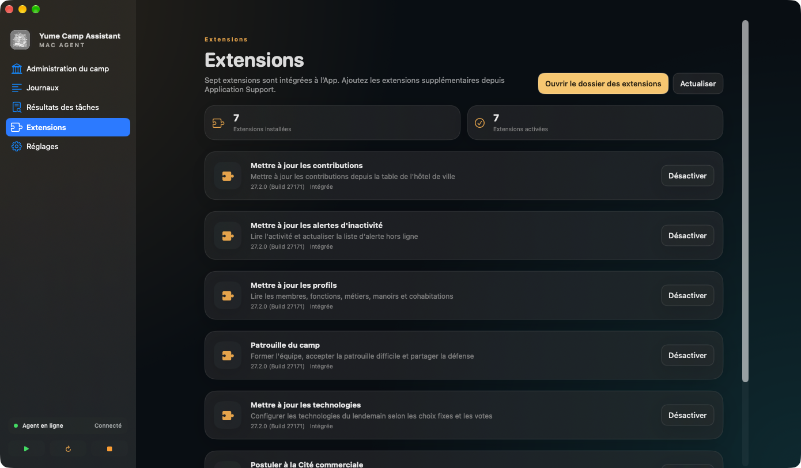
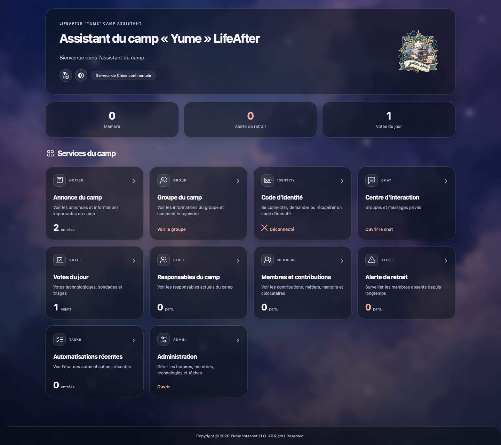
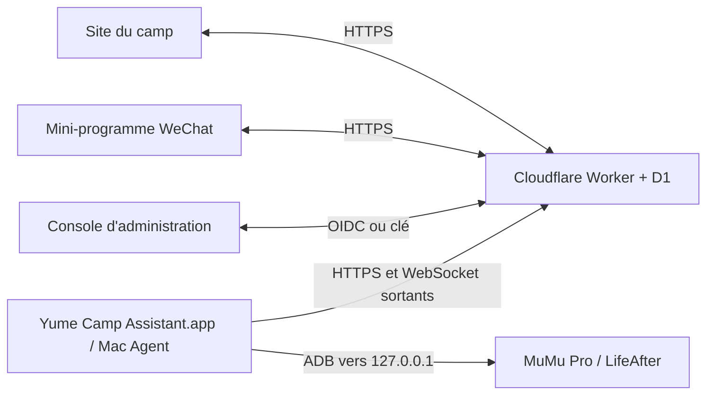

# Yume Camp Assistant

  

  <a href="https://github.com/YumePrincess/yume-life-after-camp-assistant">Dépôt GitHub</a>
  · <a href="docs/DEPLOYMENT.fr.md">Guide de déploiement</a>
  · <a href="LICENSE">Licence Apache-2.0</a>

Langues : [English (par défaut)](README.md) · [简体中文](README.zh-CN.md) ·
[繁體中文](README.zh-TW.md) · Français · [日本語](README.ja.md)

Yume Camp Assistant réunit un site de camp LifeAfter, une console d’administration,
une API publique pour mini-programme WeChat et une application macOS native
d’automatisation. Cloudflare Workers conserve les plannings et l’état des tâches ;
le Mac Agent agit localement dans le jeu avec MuMu et Android Debug Bridge (ADB).

## Pourquoi Cloudflare Workers ?

Le site, l’API et les fichiers statiques se déploient ensemble, sans serveur
toujours actif à provisionner, système d’exploitation à maintenir ni parc de
serveurs Web à administrer. Le code Worker s’exécute sur le réseau périphérique
de Cloudflare et s’adapte au volume de requêtes ; `workers.dev` fournit aussi une
adresse de déploiement sans configurer de domaine au préalable. Les liaisons
gérées D1, R2 et Durable Objects apportent base de données, stockage de fichiers
et coordination. Aucun forfait Workers payant n’est requis : un camp modeste peut
utiliser Workers Free dans les quotas gratuits actuels de Workers, D1, Durable
Objects et R2. Ces quotas sont limités et peuvent changer ; les dépassements,
services payants facultatifs ou tiers peuvent coûter de l’argent. Vérifiez les
[limites et tarifs Workers](https://developers.cloudflare.com/workers/platform/limits/)
et les [tarifs R2](https://developers.cloudflare.com/r2/pricing/) avant la production.

## Captures de démonstration

  
  

*Les captures de l’application Mac et du site du camp sont affichées en français, comme ce README.*

## Fonctionnalités

- **Site et console d’administration :** publier des annonces, des informations sur le camp,
  les membres, les contributions et l’activité, les votes technologiques et les instructions
  de groupe. Les administrateurs planifient des tâches, ajoutent des tâches manuelles à la
  file, consultent les journaux et interrompent une exécution.
- **Application Mac native `Yume Camp Assistant.app` :** installer et gérer l’Agent local,
  consulter son état et ses journaux, lancer ou arrêter des tâches, gérer les plugins et
  ouvrir la console du camp. Compatible avec les Mac Apple Silicon sous macOS 26 ou version ultérieure.
  L’Agent d’automatisation est pris en charge uniquement sur cette plateforme ; le projet peut ne pas
  développer d’Agent pour Windows ou d’autres plateformes.
- **Sept plugins d’automatisation intégrés :** technologies, profils des membres,
  contributions, alertes de risque d’absence, activité hebdomadaire, inscription à Trading City
  et patrouille du camp.
- **Contrôle local du jeu :** l’Agent utilise ADB sur le port loopback de MuMu et ouvre une
  connexion sortante vers Workers. Le Worker ne se connecte jamais à un port ADB public.
  Un modèle de vision Qwen local, facultatif, peut aider à classifier certains écrans ; les
  actions exécutées restent calibrées. En Chine continentale, le téléchargement du modèle
  facultatif peut échouer avec une connexion directe ; organisez vous-même l’accès réseau ou
  l’obtention des fichiers si vous souhaitez l’utiliser. Installez LifeAfter depuis la boutique d’applications
  intégrée à MuMu. Dans les paramètres du jeu, remplacez la touche de libération de la souris
  `~` par défaut par `=` ; l’Agent attend `=`.
- **Données communes :** le site et le mini-programme WeChat peuvent utiliser la même API
  publique et la même configuration. OIDC est activable ou désactivable ; les administrateurs
  peuvent aussi utiliser une clé Wrangler ou des clés à permissions limitées créées dans la console.

### Catalogue complet des fonctionnalités

#### Site public du camp

- **Tableau de bord :** une page d’accueil responsive et multilingue affiche le nom du camp, le serveur, le fuseau horaire, l’heure de réinitialisation quotidienne, les statistiques et les accès aux annonces, au guide de groupe, à l’identité, au Centre d’interaction, aux votes, aux membres, aux alertes d’inactivité et aux tâches récentes. Langues : chinois simplifié et traditionnel, anglais, français et japonais. Thème clair, sombre ou système.
- **Annonces et informations :** les administrateurs gèrent les annonces, le nom du camp, le serveur, le site, le fuseau horaire, l’heure de réinitialisation et la visibilité des membres.
- **Guide des groupes :** les instructions sont modifiées en Markdown dans la console. Texte, sauts de ligne, liens HTTPS, images distantes (par exemple les QR codes) et images statiques hébergées sur le site sont pris en charge.
- **Responsables et annuaire :** affiche les responsables du camp. Si l’annuaire public est activé, les membres peuvent consulter le nom du joueur, sa profession, son niveau de manoir, son colocataire, ses contributions de la semaine, ses points technologiques utilisés, ses fournitures et son activité hebdomadaire. La liste est consultable et ouvre une fiche détaillée.
- **Alerte d’inactivité :** signale les membres dont l’inactivité dépasse le seuil configuré. Cette liste sert au suivi ; le système ne retire personne du jeu.
- **État des tâches :** affiche les exécutions récentes et leur état afin de suivre l’actualisation des données et de l’automatisation.

#### Identité, éligibilité et participation

- **Compte du camp :** demande d’un code d’identité unique à huit chiffres, connexion avec ce code et un mot de passe, consultation du nom du joueur, de l’adresse e-mail, de l’avatar, de la validité et de l’éligibilité au vote.
- **Cycle du compte :** demande initiale, prolongation, réémission ou annulation du code ; récupération d’un code oublié et réinitialisation du mot de passe à partir des informations de demande et de l’adresse réservée. Les administrateurs examinent les demandes en attente.
- **Profil :** modification du nom du joueur et de l’avatar, changement de mot de passe, consultation des critères de vote et demande d’une dérogation si les seuils de participation ne sont pas atteints.
- **Contrôles côté serveur :** l’identité et l’éligibilité sont vérifiées lors de l’envoi d’un vote et de l’accès aux services protégés. L’autorisation temporaire de vote pendant une prolongation en attente ne rétablit pas les autres accès d’un compte expiré.

#### Vote technologique, sondages et tirages au sort

- **Vote pour les technologies du lendemain :** recherche dans le catalogue multilingue, consultation des descriptions et prérequis, puis dépôt d’un bulletin pendant la plage configurée. Le site et le mini-programme WeChat actualisent les résultats et l’état de participation. Le nombre maximal de choix est configurable (six par défaut) ; choisir une technologie avec prérequis inclut également celui-ci dans la sélection et la limite.
- **Planification technologique :** les administrateurs définissent les horaires, critères d’éligibilité, catégories et libellés, limites des emplacements cœur/généraux et préréglages fixes par date. L’Agent combine ces choix avec le vote pour préparer les technologies du lendemain. L’historique présente les bulletins, choix fixes et plans finalisés.
- **Couverture du catalogue :** la liste actuelle n’inclut pas toutes les technologies, car notre camp ne les a pas toutes débloquées. Si votre camp a besoin d’options manquantes, ajoutez-les vous-même au code source. Nous ne promettons pas qu’une version future complétera les options restantes.
- **Sondages quotidiens :** création de sondages à durée limitée avec titre et description enrichis, choix, nombre de sélections par personne, délai de révélation anticipée et vérification d’éligibilité facultative. Les membres participent pendant l’ouverture et consultent les résultats récents.
- **Tirages au sort :** création d’un tirage avec dates d’ouverture et de clôture, nombre de gagnants, numéro de lot, code de type, critères d’éligibilité et option de plafond mensuel de gains. La page publique conserve les participations et affiche les participants et gagnants à l’heure prévue.
- **Historique :** les membres consultent les résultats récents. Les administrateurs autorisés peuvent rechercher par date et gérer les archives technologiques et quotidiennes.

#### Centre d’interaction

- **Groupe du camp et messages privés :** accès au groupe de tous les membres et aux conversations individuelles. L’annuaire et la présence en ligne sont actualisés en temps réel ; plusieurs appareils peuvent être connectés au même compte.
- **Messages et médias :** rédaction enrichie, mentions, réponses, épinglage de messages, envoi d’images, vidéos, audio/notes vocales et fichiers. Aperçu ou lecture selon les formats pris en charge par le navigateur ; progression affichée pendant l’envoi.
- **Actions sur les messages :** l’auteur peut retirer ses propres messages pendant le délai prévu. Les aperçus, états non lus et synchronisations après reconnexion sont maintenus.
- **Notifications :** alertes dans la page et Web Push facultatif pour les messages privés, mentions, réponses et activité de groupe. Les versions iOS compatibles peuvent recevoir des notifications depuis le site ajouté à l’écran d’accueil.
- **Administration :** les administrateurs autorisés peuvent consulter les conversations (y compris privées), messages et fichiers, régler la conservation et les règles d’envoi, et changer l’avatar du groupe général. Le Centre utilise l’identité du camp et ne dispose pas de comptes séparés.

#### Console d’administration

- **Vue opérationnelle :** suivi des appareils Agent, des exécutions récentes et des plugins activés ; sélection de l’unique appareil autorisé à recevoir les tâches ; lancement manuel et interruption d’une tâche en cours.
- **Planning et exécution :** configuration du fuseau, des horaires, des fenêtres d’interrogation de l’Agent, du watchdog du jeu et des patrouilles ; consultation de l’historique, des journaux, instantanés, tentatives et erreurs. Après une nouvelle installation, toutes les tâches planifiées sont désactivées et peuvent être activées séparément après vérification.
- **Configuration du camp :** identité du site, annonces publiques, Markdown du groupe, visibilité des membres, heure de réinitialisation, période du vote technologique et seuils d’éligibilité.
- **Membres et identités :** recherche et modification des fiches, examen des demandes d’identité et de modification de profil, émission/gestion des codes ; configuration SMTP et test d’envoi.
- **Votes :** gestion du catalogue et des préréglages technologiques, consultation ou suppression de l’historique, critères d’éligibilité, création de sondages et de tirages, consultation des participants/gagnants et recherche d’archives quotidiennes.
- **Clés et permissions :** OIDC facultatif ou clé administrateur permanente configurée dans Wrangler. Création de clés nommées avec permissions de lecture, écriture et exécution par module, révocation et contrôle de l’ouverture de la connexion par clé.
- **Plugins :** activation ou désactivation des plugins Worker intégrés. La désactivation bloque les nouvelles tâches planifiées et manuelles et masque les permissions correspondantes, tout en conservant les données historiques et paramètres.

#### Application Mac et Agent local

- **`Yume Camp Assistant.app` :** application SwiftUI de configuration et de contrôle pour les Mac Apple Silicon sous macOS 26 ou ultérieur. Configure l’URL Workers, les identifiants Agent, l’identifiant stable et le nom de l’appareil ; installe, répare, redémarre ou supprime le LaunchAgent ; affiche l’état de santé et les journaux ; démarre, arrête ou interrompt les tâches.
- **Environnement et migration :** l’assistant prépare Node.js et les dépendances locales. Les mises à jour conservent la configuration ; une sauvegarde de migration peut inclure les paramètres, plugins, identifiants et fichiers de modèle visuel facultatifs.
- **Plugins :** gestion des sept tâches intégrées et des plugins Agent locaux supplémentaires. L’application ne télécharge pas les plugins locaux depuis le Worker.
- **Automatisation locale :** l’Agent pilote l’émulateur Android MuMu configuré via ADB sur l’interface loopback, avec OCR et actions d’écran calibrées. Le service de vision Qwen local facultatif aide à classer certains écrans sans générer de coordonnées arbitraires. En Chine continentale, son téléchargement peut échouer avec une connexion directe ; organisez vous-même l’accès réseau ou l’obtention des fichiers du modèle si vous souhaitez l’utiliser.
- **Récupération et réseau :** reconnexion à Workers, état de santé, récupération d’un jeu figé ou bloqué selon le watchdog et nettoyage des captures temporaires après les tâches. L’Agent ouvre les connexions HTTPS/WebSocket sortantes ; aucun port ADB public n’est nécessaire.

#### Les sept tâches intégrées

1. **Mettre à jour les technologies :** lire les votes et les choix fixes, puis configurer les technologies du lendemain dans le jeu.
2. **Mettre à jour les profils :** valider une lecture complète, puis synchroniser la liste, les professions, manoirs, colocations et rôles du camp.
3. **Mettre à jour les contributions :** actualiser les contributions, points technologiques utilisés et fournitures sans supprimer de membres.
4. **Actualiser l’alerte d’inactivité :** lire la dernière activité et mettre à jour la liste, sans expulser de membres.
5. **Actualiser l’activité hebdomadaire :** lire le classement du programme hebdomadaire et mettre à jour les points des membres.
6. **Inscrire à Trading City :** naviguer vers le PNJ requis et soumettre l’inscription/l’enchère pour le jour configuré.
7. **Patrouille du camp :** former une équipe, emprunter l’itinéraire difficile configuré et partager la cible de défense des livres dans le chat du camp à l’intervalle défini.

Le site et le mini-programme WeChat partagent l’API publique et les données du camp. Les workflows d’automatisation visent les serveurs de LifeAfter en Chine continentale et l’édition chinoise continentale de l’émulateur MuMu. Les éditions internationales peuvent avoir des écrans et des parcours différents ; leurs utilisateurs doivent adapter eux-mêmes le code source concerné. L’automatisation nécessite un Mac local, MuMu et une session de jeu valide. Le projet n’héberge pas de comptes et ne contourne pas les contrôles d’accès du jeu. L’automatisation de jeu de la version open source avait passé les tests au 22 novembre 2026. Les mises à jour ultérieures de LifeAfter peuvent modifier les touches, les parcours ou les positions d’action ; le projet peut ne pas fournir de correctif ni de nouvelle version pour ces changements.

## Exemple d’utilisation

1. Un administrateur met à jour les horaires, les annonces et les membres dans la console web.
2. Il configure les votes technologiques et les tâches récurrentes dans le fuseau horaire du camp.
3. L’application Mac maintient un Agent sélectionné en ligne. À l’heure prévue, Workers met une
   tâche en file et l’Agent l’exécute dans l’instance MuMu configurée.
4. L’administrateur consulte les résultats, les instantanés de contribution/activité et les
   journaux, puis peut interrompre une tâche si nécessaire.

Le projet vise les camps qui disposent déjà d’un Mac administrateur et de MuMu. Il ne fournit
pas de compte de jeu hébergé et ne contourne pas les contrôles d’accès du jeu.

## Architecture

Le dépôt contient :

- `Workers/` — Worker Cloudflare, site statique, migrations D1, API et console.
- `Mac/` — runtime de l’Agent, workflows, outils ADB/OCR et service de vision facultatif.
- `MacApp/` — application SwiftUI native et scripts de construction de l’installateur.

## Déploiement et installation

Commencez par le [guide de déploiement en cinq langues](docs/DEPLOYMENT.fr.md), qui couvre
Cloudflare Workers/D1, OIDC facultatif, la clé administrateur, le Mac Agent et la construction
de l’application. Références détaillées : [`Workers/README.md`](Workers/README.md),
[`Mac/README.md`](Mac/README.md) et [`MacApp/README.md`](MacApp/README.md).

## Copyright et licence

Copyright © 2026 **Yume Internet LLC**. Le projet est distribué sous la
[licence Apache 2.0](LICENSE), qui autorise gratuitement son utilisation, sa modification et sa
redistribution. Conservez les mentions de copyright et d’attribution Yume Internet LLC, joignez
la licence aux redistributions et signalez les fichiers modifiés conformément à Apache-2.0 ; ne
remplacez ni ne supprimez l’information du titulaire initial.

`Workers/chat/` conserve sa [licence GPL-3.0 distincte](Workers/chat/LICENSE). Les dépendances et
les contenus tiers gardent leurs licences respectives. Les captures LifeAfter sont illustratives
et ne sont pas relicenciées par ce dépôt.

## Un mot du développeur

J’ai commencé ce projet comme maire, avec l’envie de rendre la vie du camp plus simple à organiser et plus ouverte à la participation. LifeAfter a évolué au fil des années, tout comme son contexte général, l’activité des serveurs et les habitudes de jeu ; gérer un camp ajoute pourtant beaucoup de petites tâches répétitives. J’ai réuni les sondages à la demande, une tombola hebdomadaire, des animations humoristiques et les informations communes afin que les membres puissent décider et s’amuser ensemble.

J’y ai consacré beaucoup de temps, d’énergie et d’argent personnel, pour financer la plateforme et les activités. J’espérais que ces efforts aideraient les personnes autour de moi, mais ils ne garantissent pas une sincérité réciproque. J’ai ensuite appris que certains membres m’avaient critiqué et insulté dans mon dos. Je ne raconte pas cela pour réclamer des remerciements ou un remboursement, mais pour reconnaître ma déception et me rappeler que la générosité doit aussi avoir des limites.

À vous, maires : connaître le visage de quelqu’un ne signifie pas connaître son cœur. Laissez la confiance se construire avec le temps, apprenez à connaître vos membres et respectez votre budget. Ne dépensez pas sans compter pour acheter leur affection ou les retenir, et ne laissez pas le jeu vous pousser à dépenser davantage que prévu. Les activités du camp devraient être un plaisir partagé, pas la facture sans fin d’un seul maire. Utilisez ce projet selon les besoins de votre camp, prenez soin les uns des autres et que votre camp prospère.
