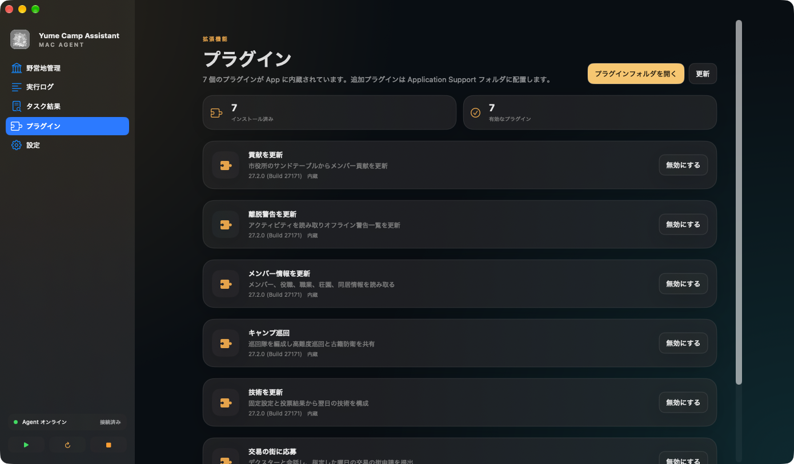
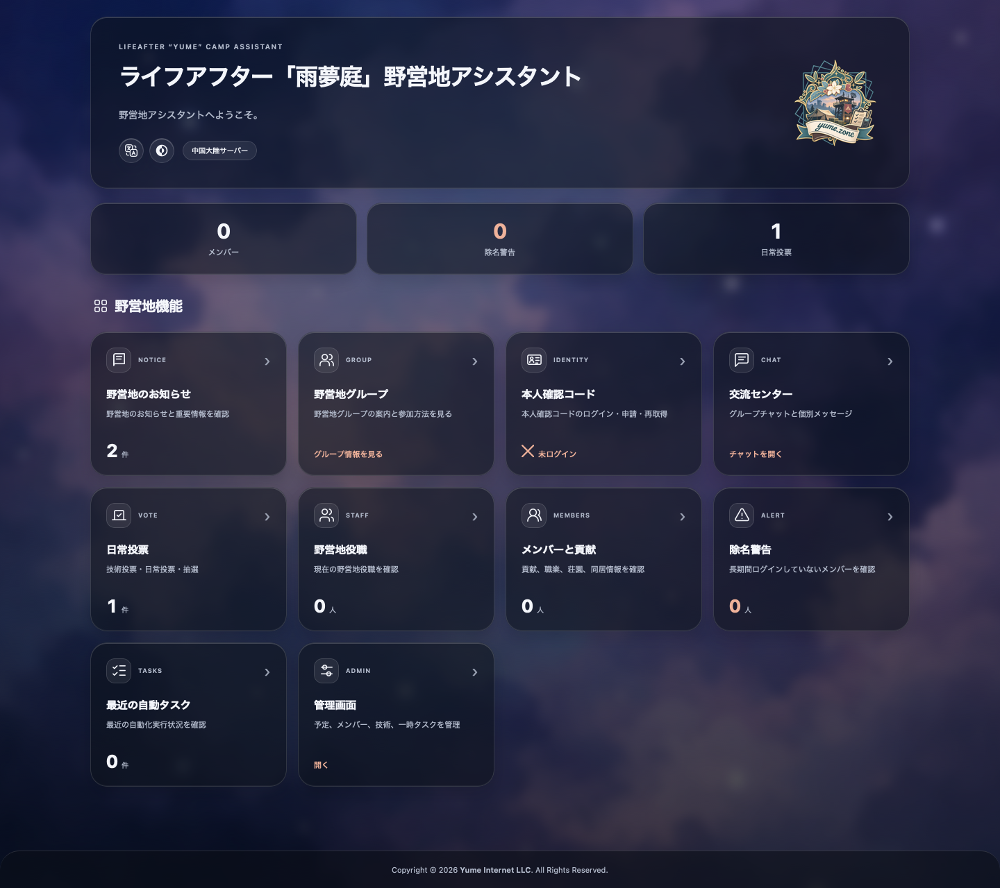
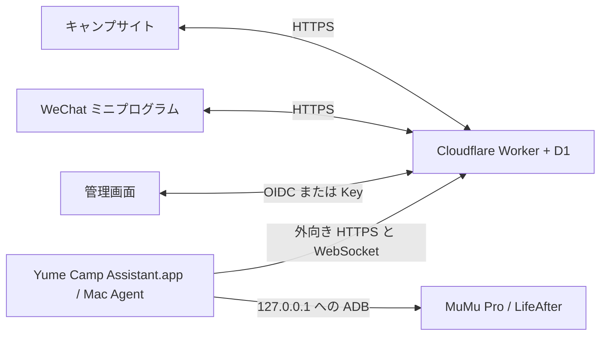

# Yume Camp Assistant

  

  <a href="https://github.com/YumePrincess/yume-life-after-camp-assistant">GitHub リポジトリ</a>
  · <a href="docs/DEPLOYMENT.ja.md">デプロイガイド</a>
  · <a href="LICENSE">Apache-2.0 ライセンス</a>

言語： [English（既定）](README.md) · [简体中文](README.zh-CN.md) ·
[繁體中文](README.zh-TW.md) · [Français](README.fr.md) · 日本語

Yume Camp Assistant は、LifeAfter のキャンプ向け公開サイト、管理画面、WeChat
ミニプログラム用の公開 API、macOS ネイティブの自動化アプリをまとめて提供します。
Cloudflare Workers がスケジュールとタスク状態を管理し、Mac Agent は MuMu と
Android Debug Bridge（ADB）を使ってゲームをローカルで操作します。

## Cloudflare Workers を使う利点

サイト、API、静的ファイルをまとめてデプロイでき、常時稼働サーバーの用意や OS の保守、
Web サーバー群の運用は不要です。Worker のコードは Cloudflare のエッジネットワークで
実行され、リクエスト量に応じてスケールします。`workers.dev` を使えば、独自ドメインを
設定する前からデプロイ先を利用できます。管理型の D1、R2、Durable Objects バインディングで
データベース、ファイル保存、協調処理を利用できます。Workers の有料プランを契約しなくても
デプロイできます。小規模なキャンプなら、Workers、D1、Durable Objects、R2 の現在の無料枠内で
Workers Free を利用できます。無料枠には上限があり、変更される場合があります。上限超過や
任意の有料機能、外部サービスには費用がかかることがあります。本番導入前に
[Workers の制限と料金](https://developers.cloudflare.com/workers/platform/limits/)と
[R2 の料金](https://developers.cloudflare.com/r2/pricing/)をご確認ください。

## デモ画像

  
  

*macOS アプリとキャンプサイトの画像は日本語表示で、README の言語に合わせています。*

## 主な機能

- **キャンプサイトと管理画面：**お知らせ、キャンプ情報、メンバー、貢献度・週間活動、
  テクノロジー投票、グループ参加案内を公開します。管理者はタスクを予約・キュー投入し、
  ログを確認して実行中のタスクを中断できます。
- **ネイティブ Mac アプリ `Yume Camp Assistant.app`：**ローカル Agent の導入と管理、状態・ログの確認、
  タスクの実行・停止、プラグイン管理、キャンプ管理画面へのアクセスができます。macOS 26 以降の
  Apple Silicon 搭載 Mac に対応します。自動化 Agent の対応環境は現在この構成のみです。Windows や
  他のプラットフォーム向け Agent は開発しない場合があります。
- **7 つの組み込み自動化プラグイン：**テクノロジー、メンバープロフィール、貢献度、オフラインリスク警告、
  週間活動、Trading City 登録、キャンプパトロール。
- **ローカルゲーム操作：**Agent は MuMu の loopback ポートへ ADB 接続し、Workers には外向き通信を行います。
  Worker が公開 ADB ポートへ接続することはありません。任意のローカル Qwen ビジョンモデルが一部画面の
  分類を補助できますが、実行する操作は校正済みの動作に限られます。中国大陸の直接接続ネットワークでは、
  任意モデルをダウンロードできない場合があります。利用する場合は、ネットワーク接続またはモデルファイルの取得を
  各自で解決してください。LifeAfter は MuMu 内蔵のアプリストアから
  インストールしてください。ゲーム内設定で、既定のマウス解放キー `~` を `=` に変更してください。Agent は `=` を使用します。
- **共通キャンプデータ：**サイトと WeChat ミニプログラムは同じ公開 API とキャンプ設定を利用できます。
  OIDC は有効/無効を切り替え可能です。管理者は Wrangler の管理 Key、または管理画面で作成した
  権限別 Key でもログインできます。

### 全機能一覧

#### 公開キャンプサイト

- **キャンプホーム：**レスポンシブで多言語対応のホームに、キャンプ名、サーバー、タイムゾーン、毎日の更新時刻、各種統計と、告知、グループ案内、ID、インタラクションセンター、投票、公職、メンバー、非アクティブ警告、最近のタスクへのカードを表示します。簡体字中国語、繁体字中国語、英語、フランス語、日本語に対応し、ライト/ダーク/システムテーマを選べます。
- **告知とキャンプ情報：**管理者は告知リスト、キャンプ名、サーバー名、サイト名、タイムゾーン、毎日の更新時刻、メンバー情報の公開設定を管理できます。
- **グループ案内：**管理画面の Markdown テキスト欄から直接編集できます。テキスト、改行、HTTPS リンク、QR コードなどの外部画像、サイト内の静的画像に対応します。
- **役職とメンバー一覧：**キャンプ役職者を表示します。公開設定が有効な場合、プレイヤー名、職業、荘園レベル、同居、週間貢献、使用済みテクノロジーポイント、物資、週間アクティビティを確認できます。検索と詳細カードにも対応します。
- **非アクティブ警告：**管理者が設定した日数を超えて活動していないメンバーを表示します。確認用の一覧であり、メンバーをゲームから追放する機能はありません。
- **タスク状況：**最近の自動タスクと状態を表示し、キャンプデータや自動処理の更新状況を確認できます。

#### ID、参加資格、メンバー参加

- **キャンプ ID アカウント：**一意の 8 桁 ID を申請し、ID とパスワードでログインします。登録プレイヤー名、メールアドレス、アバター、有効期限、投票資格を確認できます。
- **アカウント手続き：**新規申請、有効期限の延長、再発行、取消を申請できます。申請情報と登録メールアドレスを使った ID の照会やパスワード再設定にも対応し、申請は管理者が審査します。
- **プロフィール：**プレイヤー名とアバターの変更、パスワード変更、投票資格基準の確認、参加条件を満たさない場合の特例申請ができます。
- **サーバー側の検証：**投票送信と ID 保護対象の機能で ID と資格を検証します。延長審査中の一時的な投票許可は、期限切れアカウントのチャットなど他のアクセスを復元しません。

#### テクノロジー投票、通常投票、抽選

- **翌日のテクノロジー投票：**多言語カタログを検索し、説明と前提テクノロジーを確認して、設定された投票時間内に投票します。サイトと WeChat ミニプログラムは投票状況を更新します。1 人あたりの選択上限は設定可能（既定は 6 件）で、前提条件のある項目を選ぶと前提項目も選択され上限に含まれます。
- **テクノロジー計画：**管理者は投票時間、資格、カテゴリと表示名、コア/一般スロット上限、日付別の固定テクノロジー設定を管理できます。Agent は投票と固定設定から翌日の構成を作成します。履歴では投票、固定項目、確定した計画を確認できます。
- **カタログの範囲：**現在の投票リストにはすべてのテクノロジーが含まれていません。私たちのキャンプで未解放の技術があるためです。必要な選択肢が不足する場合は、利用者自身でソースコードに追加してください。今後のリリースで残りの項目を補完することは約束できません。
- **日常投票：**管理者は期限付きの投票を作成し、リッチテキストの題名と説明、選択肢、1 人あたりの選択数、結果の事前公開時刻、資格確認を設定できます。メンバーは開催中に参加し、最近の結果を確認できます。
- **抽選：**管理者は開始・締切時刻、当選人数、バッチ番号、種別コード、参加資格、月間当選数上限の適用を設定して抽選を作成できます。公開ページは参加者を記録し、公開時刻以降に参加者と当選者を表示します。
- **履歴：**メンバーは最近のテクノロジー投票と日常投票・抽選の結果を確認できます。権限を持つ管理者は日付で検索し、履歴を管理できます。

#### インタラクションセンター

- **グループとダイレクトメッセージ：**全メンバーグループと 1 対 1 の会話を利用できます。メンバー一覧とオンライン状態はリアルタイムで更新され、複数端末での利用に対応します。
- **メッセージとメディア：**リッチテキスト、メンション、返信、メッセージのピン留め、画像、動画、音声/ボイスメッセージ、ファイル送信に対応します。ブラウザーが対応する形式はプレビュー/再生でき、アップロードの進行状況も表示します。
- **メッセージ操作：**送信者は規定時間内に自分のメッセージを取り消せます。会話プレビュー、未読状態、再接続後の同期も更新されます。
- **通知：**ページ内通知と任意の Web Push で、DM、メンション、返信、グループ活動を通知できます。対応する iOS ではホーム画面に追加した Web App から通知を受け取れます。
- **管理：**権限を持つ管理者は DM を含む会話、メッセージ、ファイルを確認し、保存期間とアップロードポリシーを設定し、全メンバーグループのアバターを変更できます。キャンプ ID を利用し、チャット専用アカウントはありません。

#### 管理画面

- **運用概要：**Agent 端末、最近の実行、プラグイン状態を確認し、キューを受け取る唯一の端末を選択します。手動実行と実行中タスクの中断もできます。
- **スケジュールと実行ポリシー：**キャンプのタイムゾーン、タスク時刻、Agent のポーリング時間帯、ゲーム watchdog、パトロール時刻を設定し、履歴、ログ、スナップショット、再試行、失敗状態を確認できます。新規インストール時は全ての自動スケジュールが無効で、設定確認後に個別に有効化できます。
- **キャンプ設定：**サイト情報、公開告知、グループ Markdown、メンバー公開、更新時刻、テクノロジー投票時間と参加基準を管理します。
- **メンバーと ID 管理：**メンバーの検索・編集、ID とプロフィール変更申請の審査、ID の発行・管理、SMTP 設定とテストメール送信ができます。
- **投票管理：**カタログと固定設定の編集、履歴の確認/削除、投票と資格設定、投票・抽選の作成、参加者/当選者の表示、日常項目の履歴検索ができます。
- **Key と権限：**OIDC を任意で有効化できます。または Wrangler の永続管理 Key を使用できます。名前付き Key にモジュール単位の読み取り/書き込み・タスク権限を設定し、失効させ、Key ログインの公開を切り替えられます。
- **プラグイン：**組み込み Worker プラグインの有効/無効を切り替えます。無効化すると新しい定期/手動実行を停止して権限を隠しますが、既存の設定と履歴は保持します。

#### Mac アプリとローカル Agent

- **`Yume Camp Assistant.app`：**macOS 26 以降の Apple Silicon Mac 向け SwiftUI 設定・管理アプリです。Workers URL、Agent 認証情報、固定デバイス ID と名前を設定し、LaunchAgent の導入、修復、再起動、削除、ヘルス状態とログの確認、タスクの開始/停止/中断を行えます。
- **環境と移行：**セットアップが Node.js と必要なローカル依存関係を準備します。更新時は設定を保持し、移行バックアップには設定、プラグイン、任意の認証情報やローカルビジョンモデルを含められます。
- **プラグイン管理：**7 つの組み込みタスクと追加のローカル Agent プラグインを管理します。Worker からローカルプラグインを取得することはありません。
- **ローカル自動化：**Agent は loopback の ADB で設定済み MuMu Android エミュレーターを操作し、OCR と校正済み画面アクションを使います。任意のローカル Qwen ビジョンサービスは一部画面の分類を補助しますが、任意の座標を生成しません。中国大陸の直接接続ネットワークでは、任意モデルをダウンロードできない場合があります。利用する場合は、ネットワーク接続またはモデルファイルの取得を各自で解決してください。
- **復旧とネットワーク：**Workers に自動再接続して状態を報告し、watchdog 設定に従ってフリーズ/応答なしのゲームを復旧し、タスク後に一時スクリーンショットを削除します。Agent が外向き HTTPS/WebSocket 接続を開始するため、公開 ADB ポートは不要です。

#### 7 つの組み込み自動化タスク

1. **テクノロジー更新：**投票と固定設定を読み、ゲーム内で翌日のテクノロジーを構成します。
2. **メンバープロフィール更新：**完全な読み取りを検証して、メンバー、職業、荘園、同居、キャンプ役職を同期します。
3. **貢献更新：**メンバーを削除せず、貢献、使用済みテクノロジーポイント、物資を更新します。
4. **非アクティブ警告更新：**最終活動を読み、警告一覧を更新します。メンバーの追放は行いません。
5. **週間活動更新：**週間計画のランキングを読み、メンバーの週間活動ポイントを更新します。
6. **Trading City 登録：**設定された曜日に指定 NPC へ移動し、競売/登録を送信します。
7. **キャンプパトロール：**チームを編成し、設定した高難度ルートに入り、設定間隔で書籍防衛の目標をキャンプチャットに共有します。

サイトと WeChat ミニプログラムは同じ公開 API とキャンプデータを使用します。ゲーム自動化ワークフローは LifeAfter の中国大陸サーバーと中国大陸版 MuMu エミュレーターを対象に設計されています。海外版のゲームやエミュレーターは画面や手順が異なる場合があり、利用者自身で該当するソースコードを調整する必要があります。自動化にはローカル Mac、設定済み MuMu、ログイン済みゲームが必要です。本プロジェクトはゲームアカウントをホストせず、ゲームのアクセス制御を回避しません。オープンソース版の Agent ゲーム自動化機能は 2026 年 11 月 22 日時点でテストに合格しています。その後の LifeAfter の更新でキー割り当て、操作手順、操作位置が変わる場合がありますが、本プロジェクトはそれらの変更に対する修正や更新版を提供しない可能性があります。

## 利用例

1. キャンプ管理者が Web 管理画面で予定、お知らせ、メンバー情報を更新します。
2. キャンプのタイムゾーンに合わせてテクノロジー投票と定期タスクを設定します。
3. Mac アプリで選択した 1 台の Agent をオンラインにします。予定時刻になると Workers がタスクをキューに入れ、
   Agent が設定済みの MuMu インスタンスで実行します。
4. 管理者は結果、貢献度/活動スナップショット、ログを確認し、必要に応じてタスクを中断できます。

このプロジェクトは、管理用 Mac と MuMu をすでに運用しているキャンプ向けです。ゲームアカウントの
ホスティングや、ゲーム独自のアクセス制御の回避は行いません。

## アーキテクチャ

リポジトリ構成：

- `Workers/` — Cloudflare Worker、静的サイト、D1 マイグレーション、API、管理画面。
- `Mac/` — Agent ランタイム、自動化ワークフロー、ADB/OCR ツール、任意のローカルビジョンサービス。
- `MacApp/` — SwiftUI ネイティブアプリとインストーラーのビルドスクリプト。

## デプロイとインストール

[5 言語のデプロイガイド](docs/DEPLOYMENT.ja.md)では、Cloudflare Workers/D1、任意の OIDC、
管理 Key、Mac Agent、ネイティブアプリのビルドを説明します。詳しくは
[`Workers/README.md`](Workers/README.md)、[`Mac/README.md`](Mac/README.md)、
[`MacApp/README.md`](MacApp/README.md) を参照してください。

## 著作権とライセンス

著作権 © 2026 **Yume Internet LLC**。本プロジェクトは
[Apache License 2.0](LICENSE) の下で公開され、個人・組織を問わず無料で使用、変更、再配布できます。
Yume Internet LLC の著作権・帰属表示を保持し、再配布にはライセンスを同梱し、Apache-2.0 の要件に従って
変更したファイルを明示してください。元の著作権者情報を置き換えたり削除したりしないでください。

`Workers/chat/` は独立した [GPL-3.0 ライセンス](Workers/chat/LICENSE)を維持します。依存関係や第三者素材は
それぞれのライセンスに従います。デモの LifeAfter 画面は説明用の第三者コンテンツで、本リポジトリの
ライセンス対象ではありません。

## 開発者からのメッセージ

このキャンプアシスタントは、市長としてキャンプ運営を整理し、メンバーが参加しやすくしたいと思ったことから作り始めました。長く続く『ライフアフター』を取り巻く環境やサーバーの活気、遊び方は少しずつ変化しますが、キャンプ運営には細かな日常作業が多くあります。必要なときの投票、毎週の抽選、遊び心のある企画、情報共有を一つの場にまとめ、みんなで決めて一緒に楽しめるようにしたいと考えました。

そのために多くの時間と労力を注ぎ、自分のお金でプラットフォームや企画の費用も負担しました。周りの人の役に立ちたいと思っていましたが、尽くした分だけ誠意が返ってくるとは限りません。後になって、一部のメンバーが陰で私を罵り、批判していたことも知りました。これは感謝や返金を求めるためではなく、失望を正直に伝え、善意にも境界が必要だと自分に言い聞かせるために書いています。

市長の皆さんへ。人の顔は知っていても心までは分からないものです。信頼は時間をかけて築き、メンバーをよく知り、無理のない範囲で運営してください。好かれるため、あるいは引き留めるために湯水のようにお金を使わず、ゲームにも予算以上を注ぎ込まないでください。キャンプの企画はみんなで分かち合う楽しみであり、市長一人の終わりない出費ではありません。必要に合わせて本プロジェクトを活用し、互いを尊重してください。利用するすべての市長のキャンプがますます発展することを願っています。
