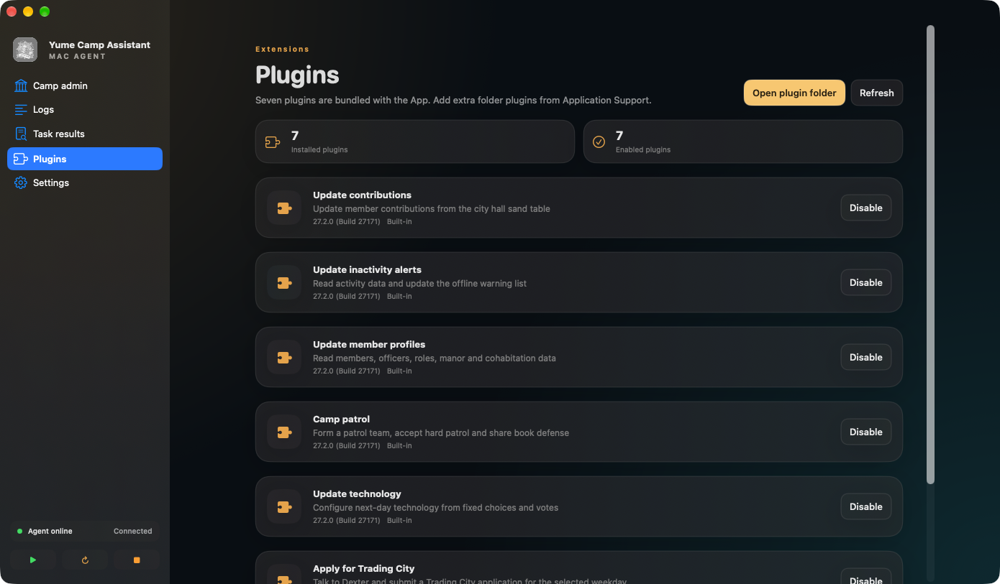
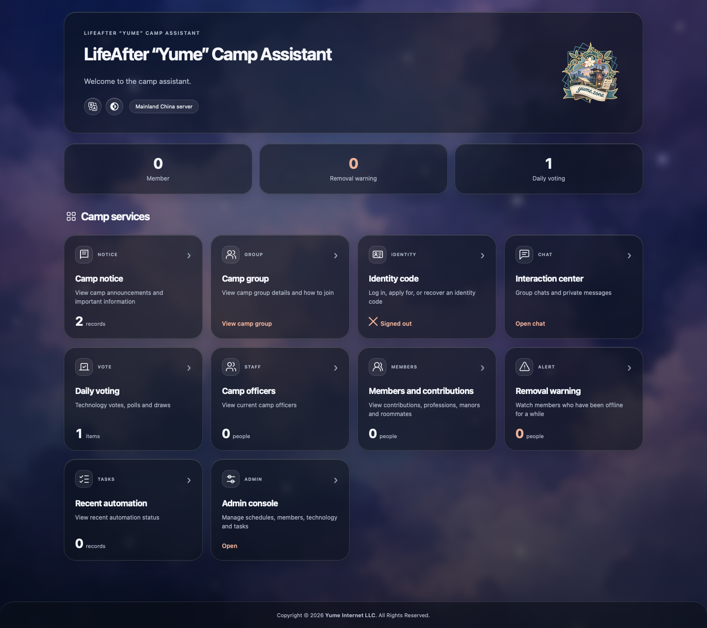
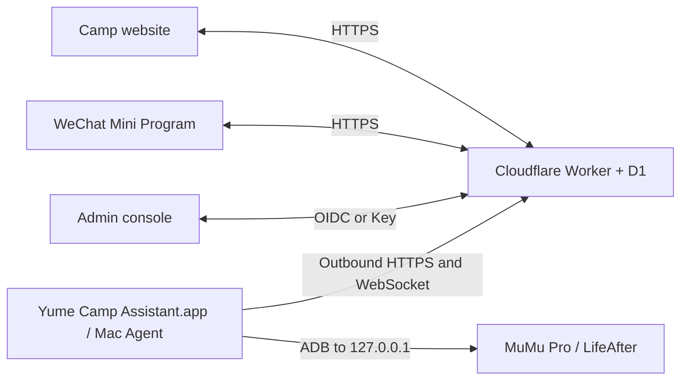

# Yume Camp Assistant

  

  <a href="https://github.com/YumePrincess/yume-life-after-camp-assistant">GitHub repository</a>
  · <a href="docs/DEPLOYMENT.md">Deployment guide</a>
  · <a href="LICENSE">Apache-2.0</a>

**English is the default language.** Read this README in
[简体中文](README.zh-CN.md) · [繁體中文](README.zh-TW.md) ·
[Français](README.fr.md) · [日本語](README.ja.md).

Yume Camp Assistant coordinates a LifeAfter camp website, administrator console,
WeChat Mini Program API, and a native macOS automation app. Cloudflare Workers
stores schedules and task state; the Mac Agent operates the game locally through
MuMu and Android Debug Bridge (ADB).

## Why Cloudflare Workers?

The website, API, and static assets deploy together without provisioning an
always-on server, maintaining an operating system, or running a web-server
fleet. Cloudflare runs Worker code across its edge network and scales it with
incoming requests; `workers.dev` also provides a deployment address without
first configuring a domain. Managed D1, R2, and Durable Objects bindings keep
the app's database, file storage, and coordination services close to the Worker.
No paid Workers plan is required: a modest camp can use the Workers Free plan
within the current Workers, D1, Durable Objects, and R2 free allowances. Those
allowances are limited and can change; usage beyond them, optional paid services,
or third-party services may cost money. Check [Workers limits and pricing](https://developers.cloudflare.com/workers/platform/limits/)
and [R2 pricing](https://developers.cloudflare.com/r2/pricing/) before production.

## Screenshots

  
  

*These screenshots show the Mac app's plugin management and the public camp site. Both are captured in English to match this README.*

## Feature catalogue

### Public camp website

- **Camp dashboard:** a responsive, multilingual home page with the camp name,
  server, timezone, daily refresh information, summary counts, and entry cards
  for the camp's public services. English, Simplified Chinese, Traditional
  Chinese, French, and Japanese are supported; users can choose light, dark, or
  system theme.
- **Announcements and camp information:** publish a headline and a list of camp
  notices. Administrators can edit the camp name, server name, site name,
  timezone, daily refresh time, and public visibility settings.
- **Camp group guide:** edit the group instructions directly in the admin
  Markdown text box. Markdown supports text, line breaks, HTTPS links, remote
  images such as QR codes, and images served from this site.
- **Public roles and member directory:** show camp staff and, when enabled,
  member names, occupations, manor level, cohabitation, contribution totals,
  technology points used, materials, and weekly activity. The directory supports
  searching members and viewing a member's detail card.
- **Inactivity warning:** display members whose last activity has crossed the
  administrator-configured threshold. This is an informational risk list; the
  system does not remove members from the game.
- **Automation status:** show recent task runs and their status so members can
  see whether camp data and scheduled automation have been refreshed.

### Identity, eligibility, and member participation

- **Camp identity codes:** apply for a unique eight-digit identity code, sign in
  with the code and password, and view the linked player name, email, avatar,
  validity period, and voting eligibility.
- **Account lifecycle:** submit applications for a new code, an extension,
  reissue, or cancellation; retrieve a forgotten code and reset a forgotten
  password using the original application details and reserved email. Pending
  applications are reviewed by camp administrators.
- **Profile controls:** update the player name and avatar, change the password,
  review eligibility criteria, and request an eligibility exception when the
  configured participation requirements are not met.
- **Participation checks:** identity and eligibility are checked by the server
  when a member submits a vote or enters identity-protected services. An
  approved extension request can receive the documented temporary voting
  allowance without restoring other expired-account access.

### Technology voting, polls, and draws

- **Next-day technology vote:** browse and search the localized technology
  catalogue, inspect descriptions and prerequisites, select technologies, and
  submit a ballot during the camp's configured voting window. The site and
  WeChat Mini Program refresh current results and participation state. The
  per-member vote limit is configurable (six by default); selecting a dependent
  technology includes its prerequisite in the limit and selection.
- **Technology planning:** administrators can configure voting hours and
  eligibility rules, technology categories and labels, core/general slot limits,
  and date-specific fixed technology presets. The Agent combines fixed choices
  with the vote result to set up the next day's technologies. Archived results
  show ballots, selected technologies, fixed choices, and finalized plans.
- **Technology catalogue coverage:** the current vote list does not include
  every technology because our camp has not unlocked them all. If your camp
  needs missing choices, add them to the source code yourself. We do not promise
  a future release will fill in the remaining options.
- **Daily polls:** administrators create time-bounded poll items with localized
  rich-text titles/descriptions, answer options, a per-member selection limit,
  early result reveal timing, and optional eligibility checks. Members can
  participate while an item is open and review recent results.
- **Member draws / raffles:** administrators create draws with an opening and
  closing time, number of winners, batch and type codes, eligibility rules, and
  the option to enforce a monthly winner cap. The public page records entries
  and displays participant and winner lists after the appropriate reveal time.
- **History:** members can browse recent technology and daily-item history;
  authorized administrators can query archived results by date and manage
  history records.

### Interaction Center

- **Camp group and direct messages:** identity-code members can use the shared
  all-members group and one-to-one conversations. The directory and online
  presence update in real time across a member's devices.
- **Rich messages and media:** compose formatted messages, mention members,
  reply to a message, pin important messages, and send images, video, audio or
  voice messages, and files. Media has previews or playback where the browser
  supports the format; uploads show progress.
- **Message controls:** authors can recall their own messages within the
  supported time window. Conversation previews, unread state, and reconnect
  synchronization are maintained as messages arrive.
- **Notifications:** in-page alerts and optional Web Push can notify members of
  direct messages, mentions, replies, and group activity. On supported iOS
  versions, notifications are available from the site added to the Home Screen.
- **Moderation and administration:** authorized admins can inspect conversations
  (including direct messages), messages and files, configure chat retention and
  upload policies, and update the all-members group avatar. Chat access uses the
  camp identity session; it has no separate account system.

### Admin console

- **Operations overview:** monitor Agent devices, recent runs, and enabled
  plugins; choose the single device allowed to receive queued work; start
  available tasks manually and interrupt a running task.
- **Schedules and execution policy:** set the camp timezone, task schedules,
  Agent polling windows, game watchdog and patrol timing. Review task history,
  logs, snapshots, retries, and failure states. On a fresh installation, all
  automatic schedules start disabled and can be enabled individually after
  reviewing the setup.
- **Camp configuration:** maintain site identity, public announcements, camp
  group Markdown, visibility, refresh time, vote windows, and eligibility
  thresholds.
- **Member and identity administration:** search and update member records,
  review identity applications and profile changes, issue or manage identity
  codes, and configure SMTP plus test email delivery.
- **Voting administration:** edit the technology catalogue and fixed presets,
  inspect or remove technology history, set voting and eligibility rules,
  create polls and draws, inspect participants and winners, and review daily
  item history.
- **Keys and permissions:** optionally use OIDC or a configured permanent
  Wrangler admin Key. Create named admin Keys with module-level read/write and
  task permissions, revoke them, and control whether Key sign-in is open.
- **Plugin controls:** enable or disable built-in server plugins. Disabling a
  plugin prevents new scheduled/manual execution and hides its permissions while
  retaining its stored history and configuration.

### Native Mac app and local Agent

- **`Yume Camp Assistant.app`:** a SwiftUI setup and control app for Apple
  Silicon Macs running macOS 26 or later. Configure the Workers URL, Agent
  credentials, stable device ID, and editable device name; install, repair,
  restart, or remove the background LaunchAgent; monitor health; view logs; and
  start, stop, or abort tasks.
  The automation Agent currently supports only Apple Silicon Macs running
  macOS 26 or later; we may not develop additional Agents for Windows or other
  platforms.
- **Runtime and migration tools:** guided setup prepares Node.js and required
  local dependencies, preserves existing settings during updates, and can import
  or export a migration backup containing configuration, plugins, optional
  credentials, and optional local vision-model files.
- **Plugin management:** manage the seven bundled tasks and install or control
  additional local Agent plugins. The app does not fetch its local plugins from
  the Worker.
- **Local automation:** the Agent controls the configured MuMu Android
  emulator through ADB on its loopback interface and uses OCR plus calibrated
  screen actions. The optional local Qwen vision service assists with selected
  screen classification; it cannot invent arbitrary screen coordinates. In
  mainland China, a direct internet connection may not complete the optional
  model download; users who need it must arrange their own network access or
  obtain the model files themselves. Install
  the LifeAfter client from MuMu's built-in app store. In the game's settings,
  change the mouse-release key from its default `~` to `=` before running tasks;
  the Agent expects `=`.
- **Resilience and privacy boundary:** the Agent reconnects to Workers, reports
  health, can recover a frozen or unresponsive game using the configured
  watchdog, and cleans up temporary screenshots after tasks. It initiates
  outbound HTTPS/WebSocket connections; Workers do not need a public ADB port.

### Seven built-in automation tasks

1. **Update technologies:** read the scheduled technology ballot and fixed
   choices, then configure the next day's technologies in game.
2. **Update member profiles:** synchronize the current member list, occupations,
   manor levels, cohabitation, and camp roles after validating a complete read.
3. **Update contributions:** refresh contribution totals, technology points
   used, and contributed materials without deleting members.
4. **Refresh inactivity warnings:** read last-active information and publish the
   warning list; it never kicks members.
5. **Update weekly activity:** read the camp's weekly plan ranking and refresh
   member weekly activity points.
6. **Register for Trading City:** navigate the game to the required NPC and
   submit the scheduled auction/registration for the configured weekday.
7. **Camp patrol:** form a patrol team, enter the configured difficult route,
   and share the book-defense target to camp chat at the configured interval.

The website and WeChat Mini Program use the same public API and camp data.
Actual game automation requires a locally configured Mac, MuMu instance, and
valid game session. The automation workflows target the LifeAfter mainland
China servers and the mainland China edition of the MuMu emulator. Overseas
game or emulator editions can have different interfaces and flows; users of
those editions must adapt the relevant source code themselves. This project
does not host game accounts or bypass game access controls. The open-source
Agent automation was tested successfully as of 2026-11-22. Later LifeAfter
updates may change key bindings, interaction flows, or screen positions; the
project may not provide fixes or updated releases for such changes.

## Typical use

1. A camp administrator publishes the camp schedule, notices, and membership
   information in the web console.
2. They configure technology voting and recurring automation times in the
   camp's time zone.
3. The Mac app keeps one selected Agent online. At a scheduled time, Workers
   queues a task and the Agent carries it out on the configured MuMu instance.
4. The administrator reviews task results, contribution/activity snapshots,
   and logs in the console, and can interrupt a running task when needed.

This project is designed for a camp that already has an administrator-operated
Mac and MuMu installation. It does not provide a hosted game account or bypass
the game's own access controls.

## Architecture

The repository contains:

- `Workers/` — Cloudflare Worker, static site, D1 migrations, APIs, and dashboard.
- `Mac/` — Agent runtime, automation workflows, ADB/ OCR helpers, and optional
  local vision service.
- `MacApp/` — native SwiftUI app and installer build scripts.

## Deploy and install

Start with the [five-language deployment guide](docs/DEPLOYMENT.md). It covers
Cloudflare Workers/D1, optional OIDC, the admin Key, the Mac Agent, and building
the native app. Component references are available in
[`Workers/README.md`](Workers/README.md), [`Mac/README.md`](Mac/README.md), and
[`MacApp/README.md`](MacApp/README.md).

## Copyright and license

Copyright © 2026 **Yume Internet LLC**. The project is available under the
[Apache License 2.0](LICENSE), which permits free use, modification, and
redistribution. Preserve the project's Yume Internet LLC copyright and
attribution notices, include the license, and mark modified files as required
by Apache-2.0. Do not replace or remove the original copyright-owner
information.

`Workers/chat/` retains its separate [GPL-3.0 license](Workers/chat/LICENSE).
Dependencies and third-party materials keep their own licenses. LifeAfter game
screens shown in the demo are illustrative third-party content and are not
licensed by this repository.

## A note from the developer

I began building this camp assistant as a mayor who wanted camp life to be easier to organize and more open to participation. LifeAfter has changed over the years, as have its wider gaming environment, server activity, and routines; meanwhile, the everyday work of running a camp can become repetitive and demanding. I put on-demand polls, a weekly raffle, playful events, and shared information in one place so members could help make decisions and enjoy camp activities together.

That work took a great deal of time, care, and personal money. I hoped those efforts would help the people around me, but effort does not guarantee sincerity in return. I later heard that some camp members had criticized and cursed me behind my back. I am not writing this to ask for praise or repayment. It is an honest account of disappointment, and a reminder that generosity also needs boundaries.

To fellow mayors: knowing someone's face is not the same as knowing their heart. Let trust grow through experience, learn who your members are, and spend within your means. Do not throw money around to win affection or keep members happy, and do not let a game draw you into spending more than you intended. Camp activities should be shared joy, not one mayor's endless bill. I hope this project serves your camp on your terms. Treat one another with respect, keep the fun alive, and may every mayor using this project see their camp thrive.
