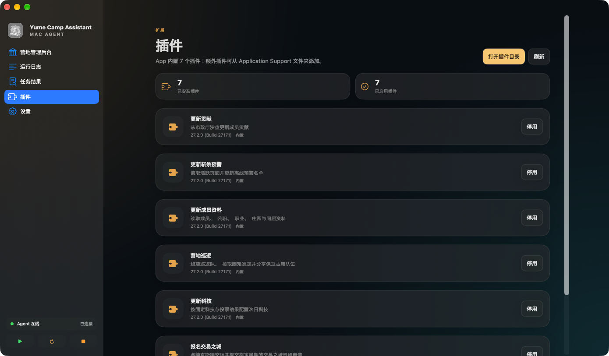
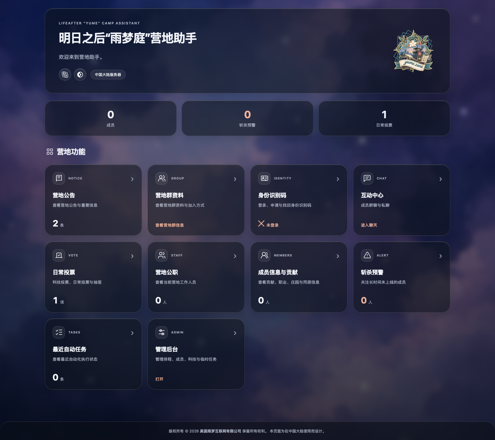
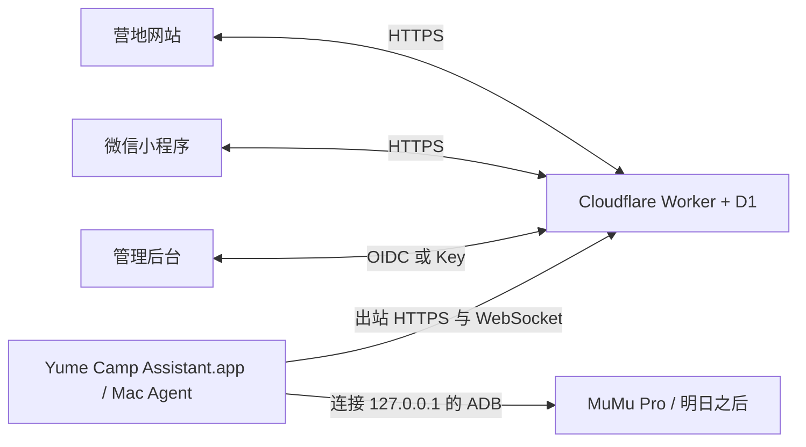

# Yume Camp Assistant

  

  <a href="https://github.com/YumePrincess/yume-life-after-camp-assistant">GitHub 仓库</a>
  · <a href="docs/DEPLOYMENT.zh-CN.md">部署指南</a>
  · <a href="LICENSE">Apache-2.0 许可证</a>

语言： [English（默认）](README.md) · 简体中文 · [繁體中文](README.zh-TW.md) ·
[Français](README.fr.md) · [日本語](README.ja.md)

Yume Camp Assistant 为《明日之后》营地提供公共网站、管理后台、微信小程序公共 API
以及原生 macOS 自动化应用。Cloudflare Workers 保存任务计划和状态；Mac Agent 通过
MuMu 与 Android Debug Bridge（ADB）在本机操作游戏。

## 使用 Cloudflare Workers 的优势

网站、API 和静态文件可以一同部署，无需配置常驻服务器、维护操作系统或管理 Web
服务器集群。Worker 代码运行在 Cloudflare 边缘网络，并随请求量扩展；`workers.dev`
还可在配置自定义域名前提供部署地址。托管式 D1、R2 和 Durable Objects 绑定可供应用
使用数据库、文件存储和协调能力。项目无需购买 Workers 付费套餐：营地规模较小时，可在
当前 Workers、D1、Durable Objects 和 R2 免费额度内使用 Workers Free 套餐部署。免费额度
有限且可能变化，超额用量、选用的付费服务或第三方服务可能产生费用。生产部署前请查看
[Workers 限额与价格](https://developers.cloudflare.com/workers/platform/limits/)和
[R2 价格](https://developers.cloudflare.com/r2/pricing/)。

## 演示图片

  
  

*截图中的 Mac 应用与营地网站均使用简体中文，与本文档语言一致。*

## 功能

- **营地网站与管理后台：**发布公告、营地资料、成员信息、贡献和活跃数据、科技投票及
  营地群说明。管理员可安排任务、加入手工任务队列、查看日志并中断运行中的任务。
- **原生 Mac 应用 `Yume Camp Assistant.app`：**安装和管理本机 Agent、查看健康状态与日志、
  执行或停止任务、管理插件，并打开营地管理后台。自动化 Agent 仅支持 macOS 26 及更新版本的
  Apple 芯片 Mac；我们可能不会为 Windows 或其他平台开发额外 Agent。
- **七个内置自动化插件：**更新科技、更新成员资料、更新贡献、离线风险预警、更新周活跃点、
  报名交易之城和营地巡逻。
- **本机游戏控制：**Agent 通过 ADB 连接 MuMu 的本机回环端口，并主动向 Workers 发起出站连接；
  Worker 不会连接公网 ADB 端口。可选的本地 Qwen 视觉模型可辅助识别部分游戏界面，实际操作仍由
  已校准的动作控制。在中国大陆直连网络环境下，可选本地模型可能无法完成下载；如需使用，请自行
  解决网络访问或模型文件获取问题。
- **共享营地数据：**网站和微信小程序可使用同一套公共 API 与营地配置。OIDC 可开关；管理员也可
  使用 Wrangler 配置的管理 Key，或后台创建的细分权限 Key。

### 完整功能目录

#### 公共营地网站

- **营地首页：**响应式、多语言首页展示营地名称、服务器、时区、每日刷新信息、营地统计，以及公告、营地群、身份识别码、互动中心、日常投票、公职、成员贡献、斩杀预警、最近自动任务等入口。支持简体中文、繁体中文、英语、法语和日语，并可选择浅色、深色或跟随系统主题。
- **公告和营地资料：**管理员可以维护首页公告列表、营地名称、服务器名称、站点名称、时区、每日刷新时间和成员信息公开设置。
- **营地群指南：**在管理后台的 Markdown 文本框中直接编辑群说明。支持文本、换行、HTTPS 链接、二维码等远程图片，以及本站静态资源图片。
- **公职与成员目录：**展示营地工作人员；启用公开成员信息后，可查看玩家名称、职业、庄园等级、同居、本周贡献、已使用科技点、贡献物资和周活跃点。成员目录支持搜索并查看详情。
- **斩杀预警：**根据管理员设置的离线天数展示长期未活跃成员，供管理者关注；系统不会自动或手动踢出成员。
- **任务状态：**展示近期自动任务和执行状态，便于成员了解营地数据和自动化最近是否更新。

#### 身份识别码、资格与成员参与

- **营地身份账号：**申请唯一的 8 位身份识别码，并用识别码和密码登录；可查看绑定的玩家名称、邮箱、头像、有效期和投票资格。
- **账号生命周期：**提交新申请、延期、重新发行或注销申请；忘记识别码时可通过申请资料找回，忘记密码时可申请重置。管理员审核待处理申请。
- **个人资料：**修改玩家名称和头像、更改密码、查看投票资格标准，并在未达到参与要求时申请破格资格。
- **服务端校验：**成员提交投票或访问受身份保护的功能时，由服务器验证身份和资格。延期审核期间的临时投票机会不会恢复过期账号的聊天等其他访问权限。

#### 科技投票、日常投票与抽签

- **次日科技投票：**浏览、搜索多语言科技目录及其说明和前置科技，在营地设定的开放时段内选择并提交投票。网站和微信小程序会刷新投票数据及参与状态。每人票数上限可配置，默认最多 6 项；选择有前置条件的科技时会自动联选前置科技并计入上限。
- **科技规划：**管理员可配置投票时间、投票资格、科技分类与显示名称、核心/通用槽位上限和按日期生效的固定科技预设。Agent 会结合固定科技和投票结果配置次日科技。历史记录可查看投票、选择结果、固定科技和最终方案。
- **科技选项范围：**目前投票目录没有包含全部科技，因为我们的营地尚未解锁所有科技。如需使用缺少的选项，请自行修改源码补充；我们不承诺在后续版本中补齐其余科技。
- **日常投票：**管理员创建限时投票事项，可设置富文本标题和说明、选项、每人可选数量、结果提前显示时间和资格校验。成员在开放期间参与，并查看近期结果。
- **抽签/抽奖：**管理员创建限时抽签，配置开奖人数、批次号、事项类型编码、资格校验，以及是否受每月中签次数上限限制。公共页面记录参与情况，并在设置的公开时间展示参与者与中签名单。
- **历史结果：**成员可浏览近期科技投票与日常事项结果；获授权的管理员可按日期查询、管理归档记录。

#### 互动中心

- **群聊和私聊：**使用营地全体成员群及一对一会话；成员通讯录和在线状态实时更新，并支持同一账号多设备在线。
- **消息和媒体：**编辑富文本消息、@成员、回复消息、置顶重要消息；发送图片、视频、音频/语音及文件。浏览器支持时可预览图片或播放媒体，上传时显示进度。
- **消息操作：**发送者可在支持的时间范围内撤回自己的消息。会话摘要、未读状态和断线重连后的消息同步会随新消息更新。
- **通知：**站内提醒和可选 Web Push 可通知私聊、@、回复及群消息。支持的 iOS 版本可从添加到主屏幕的网站接收推送。
- **后台管理：**具备相应权限的管理员可以查看包括私聊在内的会话、消息和文件，调整保留期与上传策略、修改全体成员群头像。聊天使用营地身份会话，没有独立账号体系。

#### 管理后台

- **运行总览：**查看 Agent 设备、近期任务和已启用插件；选择唯一可接收队列任务的设备；手工启动可用任务，并在必要时中断运行中任务。
- **排程与执行策略：**设置营地时区、任务计划、Agent 轮询窗口、游戏看门狗和巡逻时间；查看任务历史、日志、快照、重试及失败状态。全新安装时所有自动定时任务默认关闭，检查设置后可逐项启用。
- **营地配置：**管理站点身份、公共公告、营地群 Markdown、成员展示、刷新时间、科技投票时段和资格门槛。
- **成员与身份管理：**搜索和修改成员记录，审批身份申请与资料变更，签发或管理身份识别码；配置 SMTP 并测试邮件投递。
- **投票管理：**维护科技目录和固定预设，查看或清理科技历史，设置投票与资格规则，创建投票和抽签，查看参与者/中签者并查询日常事项历史。
- **Key 和权限：**可选启用 OIDC，也可使用 Wrangler 配置的永久管理 Key。后台可创建具名、按模块划分读写与任务权限的 Key，撤销 Key，并控制是否开放 Key 登录。
- **插件控制：**启用或停用内置服务端插件。停用后不会创建新定时任务或接受手动执行，相关权限会隐藏，但已有业务数据和历史配置仍保留。

#### Mac 应用与本机 Agent

- **`Yume Camp Assistant.app`：**面向 macOS 26 及以上版本 Apple 芯片 Mac 的 SwiftUI 安装与控制应用。设置 Workers 地址和 Agent 凭据、稳定设备 ID 与设备名称；安装、修复、重启或卸载后台 LaunchAgent；查看健康状态和日志；启动、停止或中断任务。
- **环境与迁移：**安装向导准备 Node.js 和所需本机依赖；更新时保留现有设置。迁移备份可按需包含配置、插件、凭据和本地视觉模型文件。
- **插件管理：**管理 7 个内置任务及额外本机 Agent 插件。本机插件不会从 Worker 下载。
- **自动化执行：**Agent 通过回环接口的 ADB 控制指定 MuMu Android 模拟器，使用 OCR 和经过校准的画面动作。可选本地 Qwen 视觉服务辅助分类部分画面，但不能任意生成点击坐标。在中国大陆直连网络环境下，可选本地模型可能无法完成下载，如需使用请自行解决网络访问或模型文件获取问题。请从 MuMu 自带的应用商店下载《明日之后》，并在游戏设置中将默认的释放鼠标按键 `~` 改为 `=`；Agent 使用 `=`。
- **恢复和网络边界：**Agent 自动重连 Workers、报告健康状态，并可按看门狗设置恢复冻结或无响应游戏；任务结束后清理临时截图。Agent 主动建立出站 HTTPS/WebSocket 连接，Workers 无需访问公网 ADB。

#### 七个内置自动化任务

1. **更新科技：**读取科技投票与固定配置，并在游戏中配置次日科技。
2. **更新成员资料：**校验完整读取后同步当前成员名单、职业、庄园、同居和营地职位。
3. **更新贡献：**刷新成员贡献、已使用科技点和贡献物资，不会因此删除成员。
4. **刷新斩杀预警：**读取成员最近活跃时间并更新预警列表，不会踢出成员。
5. **更新周活跃点：**读取营地周计划排行并更新成员周活跃点。
6. **报名交易之城：**按计划前往游戏指定 NPC，为设定的星期提交交易之城竞价/报名。
7. **营地巡逻：**组建巡逻队、进入设定的困难路线，并按配置间隔向营地频道分享保卫古籍目标。

网站与微信小程序共用公共 API 和营地数据。游戏自动化流程针对《明日之后》中国大陆服务器及中国大陆版 MuMu 模拟器设计。海外版本的游戏或模拟器可能有不同界面和流程，使用者需自行修改相关源代码。本项目不托管游戏账号，也不绕过游戏访问控制。本项目开源版本的 Agent 自动化游戏操作功能截至 2026 年 11 月 22 日已测试通过。未来游戏更新可能改变键位、操作流程或操作位置；项目方可能不会因此提供修复或版本更新。

## 实际使用流程

1. 营地管理员在网站后台维护日程、公告和成员信息。
2. 配置科技投票及营地时区下的定时任务。
3. Mac 应用保持一台已选定的 Agent 在线。到达计划时间后，Workers 将任务入队，由 Agent 在配置的
   MuMu 实例中执行。
4. 管理员在后台检查执行结果、贡献/活跃快照和日志；需要时可中断任务。

本项目适用于已经有管理员 Mac 与 MuMu 环境的营地，不提供托管游戏账号，也不会绕过游戏本身的访问控制。

## 架构

目录：

- `Workers/` — Cloudflare Worker、静态网站、D1 迁移、API 与后台。
- `Mac/` — Agent 运行时、自动化流程、ADB/OCR 工具和可选本地视觉服务。
- `MacApp/` — SwiftUI 原生应用和安装包构建脚本。

## 部署与安装

请从[五语言部署指南](docs/DEPLOYMENT.zh-CN.md)开始，其中介绍 Cloudflare Workers/D1、可选 OIDC、
管理员 Key、Mac Agent 和原生应用构建。组件细节见
[`Workers/README.md`](Workers/README.md)、[`Mac/README.md`](Mac/README.md) 和
[`MacApp/README.md`](MacApp/README.md)。

## 著作权与许可证

本项目著作权归 **Yume Internet LLC** 所有，© 2026。项目采用
[Apache License 2.0](LICENSE)，任何组织和个人均可免费使用、修改和再发布。请保留项目中
Yume Internet LLC 的著作权及署名信息，随再发布版本附带许可证，并按 Apache-2.0 标注修改过的文件；
不得替换或删除原版权人信息。

`Workers/chat/` 保留其独立的 [GPL-3.0 许可证](Workers/chat/LICENSE)。依赖和第三方素材仍适用各自许可证。
演示中的《明日之后》游戏界面属于第三方内容，不由本项目许可证授权。

## 开发者寄语

开发这个营地助手，起点是我作为市长，希望营地事务更容易组织，也更方便大家参与。《明日之后》运营多年，游戏大环境、服务器活跃度和玩法都在变化；营地管理却常常落在重复琐碎的日常里。我把按需投票、每周抽奖、整活娱乐和信息整理做进平台，希望成员不只是查看公告，也能一起决定、一起玩得开心。

为此我投入了大量时间、心血和自己的钱，承担平台与活动的开销。我曾希望这些付出能让身边的人过得更好，但付出不一定换来同等的真心。后来我也听说，有营地成员在背后唾骂、议论我。写下这些不是为了讨要感谢或补偿，而是诚实地承认失望，也提醒自己善意需要边界。

想对各位市长说：知人知面不知心，信任要在相处中慢慢建立。多了解营地成员，量力而行；不要为了取悦营友或挽留关系而“大撒币”，也别让游戏带着自己不断超预算消费。营地活动应该是大家共同的快乐，而不是市长一个人的账单。希望你按营地需要使用本项目，彼此尊重、保留玩游戏的乐趣，也祝每一位使用本项目的市长营地蒸蒸日上。
