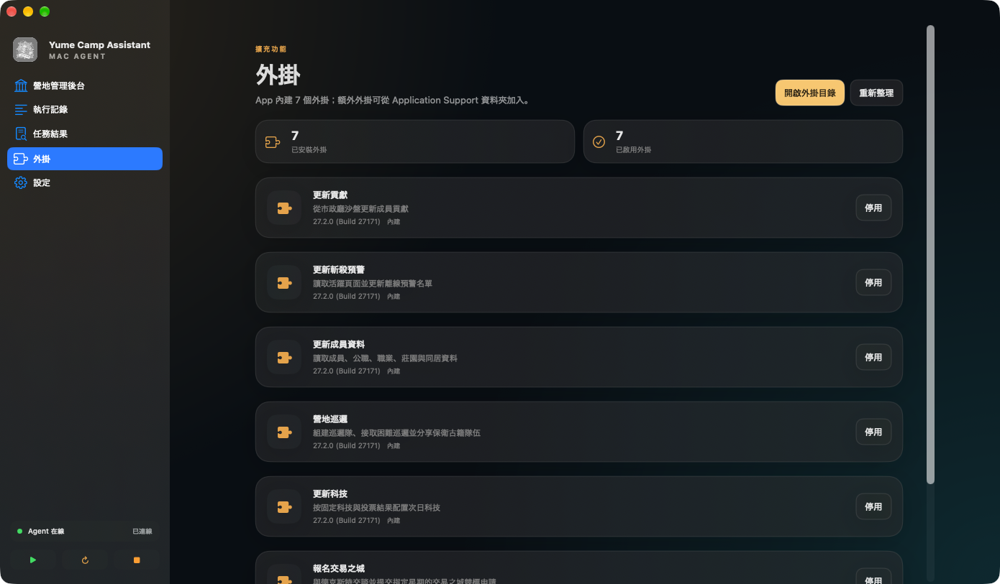
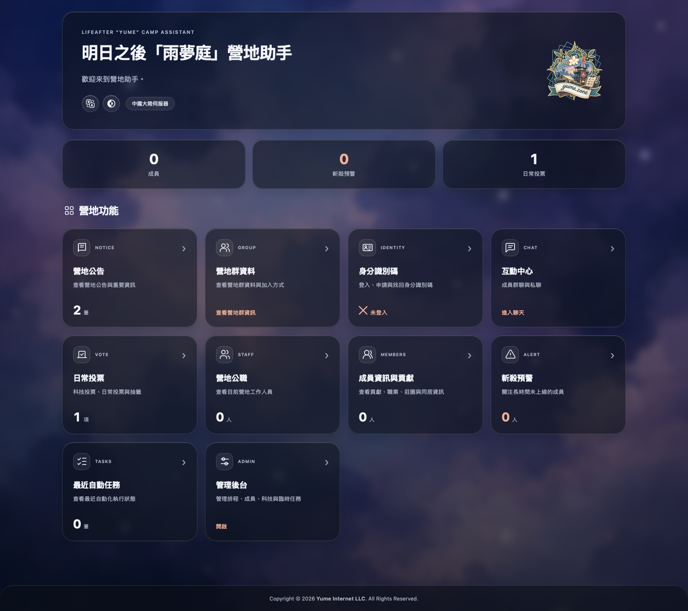
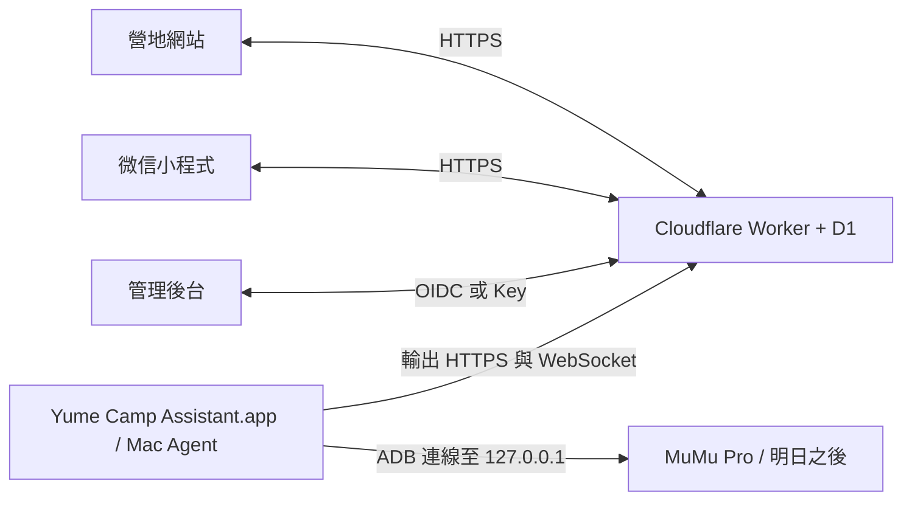

# Yume Camp Assistant

  

  <a href="https://github.com/YumePrincess/yume-life-after-camp-assistant">GitHub 儲存庫</a>
  · <a href="docs/DEPLOYMENT.zh-TW.md">部署指南</a>
  · <a href="LICENSE">Apache-2.0 授權條款</a>

語言： [English（預設）](README.md) · [简体中文](README.zh-CN.md) · 繁體中文 ·
[Français](README.fr.md) · [日本語](README.ja.md)

Yume Camp Assistant 為《明日之後》營地提供公開網站、管理後台、微信小程式公開 API
及原生 macOS 自動化應用程式。Cloudflare Workers 儲存任務排程與狀態；Mac Agent 透過
MuMu 和 Android Debug Bridge（ADB）在本機操作遊戲。

## 使用 Cloudflare Workers 的優點

網站、API 與靜態檔案可一併部署，不必配置常駐伺服器、維護作業系統或管理 Web
伺服器叢集。Worker 程式碼在 Cloudflare 邊緣網路執行，並隨請求量擴展；`workers.dev`
也能在設定自訂網域前提供部署網址。託管式 D1、R2 與 Durable Objects 綁定，讓應用程式
使用資料庫、檔案儲存與協調功能。專案不需要購買 Workers 付費方案：營地規模較小時，可在
目前 Workers、D1、Durable Objects 與 R2 免費額度內使用 Workers Free 方案部署。免費額度
有限且可能變更，超額用量、選用的付費服務或第三方服務可能產生費用。正式部署前請查看
[Workers 限制與價格](https://developers.cloudflare.com/workers/platform/limits/)及
[R2 價格](https://developers.cloudflare.com/r2/pricing/)。

## 示範圖片

  
  

*Mac 應用程式與營地網站截圖均以繁體中文顯示，與本文檔語言一致。*

## 功能

- **營地網站與管理後台：**發布公告、營地資料、成員資訊、貢獻與活躍資料、科技投票和營地群說明。
  管理員可排程任務、加入手動任務佇列、檢視記錄並中斷執行中的任務。
- **原生 Mac 應用程式 `Yume Camp Assistant.app`：**安裝和管理本機 Agent、檢視健康狀態與記錄、
  執行或停止任務、管理外掛並開啟營地管理後台。自動化 Agent 僅支援 macOS 26 及更新版本的
  Apple 晶片 Mac；我們可能不會為 Windows 或其他平台開發額外 Agent。
- **七個內建自動化外掛：**更新科技、更新成員資料、更新貢獻、離線風險預警、更新週活躍點、
  報名交易之城和營地巡邏。
- **本機遊戲控制：**Agent 透過 ADB 連線至 MuMu 的本機迴路埠，並主動向 Workers 建立輸出連線；
  Worker 不會連線至公開 ADB 埠。選用的本機 Qwen 視覺模型可協助辨識部分遊戲畫面，實際操作仍由
  已校準的動作控制。在中國大陸直連網路環境下，選用的本機模型可能無法完成下載；如需使用，請自行
  處理網路連線或模型檔案取得問題。
- **共用營地資料：**網站和微信小程式可使用同一組公開 API 與營地設定。OIDC 可開關；管理員也可
  使用 Wrangler 設定的管理 Key，或後台建立的細分權限 Key。

### 完整功能目錄

#### 公開營地網站

- **營地首頁：**響應式、多語言首頁展示營地名稱、伺服器、時區、每日刷新資訊、營地統計，以及公告、營地群、身份識別碼、互動中心、日常投票、公職、成員貢獻、斬殺預警、近期自動任務等入口。支援簡體中文、繁體中文、英語、法語和日語，並可選擇淺色、深色或跟隨系統主題。
- **公告與營地資料：**管理員可維護首頁公告列表、營地名稱、伺服器名稱、站點名稱、時區、每日刷新時間和成員資訊公開設定。
- **營地群指南：**直接在管理後台的 Markdown 文字框編輯群組說明。支援文字、換行、HTTPS 連結、QR Code 等遠端圖片，以及本站靜態資源圖片。
- **公職與成員目錄：**展示營地工作人員；啟用公開成員資訊後，可查看玩家名稱、職業、莊園等級、同居、本週貢獻、已使用科技點、貢獻物資和週活躍點。成員目錄支援搜尋和查看詳細資料。
- **斬殺預警：**依管理員設定的離線天數展示長期未活躍成員，供管理者關注；系統不會自動或手動踢出成員。
- **任務狀態：**展示近期自動任務及執行狀態，方便成員查看營地資料和自動化最近是否更新。

#### 身份識別碼、資格與成員參與

- **營地身份帳號：**申請唯一的 8 位身份識別碼，並以識別碼和密碼登入；可查看綁定的玩家名稱、電子郵件、頭像、有效期限和投票資格。
- **帳號生命週期：**提交新申請、延期、重新發行或註銷申請；忘記識別碼時可透過申請資料找回，忘記密碼時可申請重設。管理員會審核待處理申請。
- **個人資料：**修改玩家名稱和頭像、更改密碼、查看投票資格標準，並在未達參與要求時申請破格資格。
- **伺服器端驗證：**成員提交投票或使用受身份保護的功能時，由伺服器驗證身份和資格。延期審核期間的臨時投票機會不會恢復過期帳號的聊天等其他存取權限。

#### 科技投票、日常投票與抽籤

- **次日科技投票：**瀏覽、搜尋多語言科技目錄及其說明和前置科技，在營地設定的開放時段內選擇並提交投票。網站和微信小程式會更新投票資料與參與狀態。每人票數上限可設定，預設最多 6 項；選擇有前置條件的科技時會自動連選前置科技並計入上限。
- **科技規劃：**管理員可設定投票時間、投票資格、科技分類與顯示名稱、核心/通用欄位上限，以及按日期生效的固定科技預設。Agent 會結合固定科技和投票結果設定次日科技。歷史記錄可查看投票、選擇結果、固定科技和最終方案。
- **科技選項範圍：**目前投票目錄尚未包含全部科技，因為我們的營地尚未解鎖所有科技。如需使用缺少的選項，請自行修改原始碼補充；我們不承諾在後續版本中補齊其餘科技。
- **日常投票：**管理員建立限時投票事項，可設定富文字標題與說明、選項、每人可選數量、結果提前顯示時間和資格驗證。成員可在開放期間參與，並查看近期結果。
- **抽籤/抽獎：**管理員建立限時抽籤，設定中籤人數、批次號、事項類型編碼、資格驗證，以及是否套用每月中籤次數上限。公開頁面會記錄參與狀況，並於設定的公開時間展示參與者和中籤名單。
- **歷史結果：**成員可瀏覽近期科技投票和日常事項結果；獲授權的管理員可依日期查詢及管理封存記錄。

#### 互動中心

- **群聊與私訊：**使用營地全體成員群和一對一對話；成員通訊錄與上線狀態即時更新，支援同一帳號多裝置上線。
- **訊息與媒體：**編輯富文字訊息、@ 成員、回覆訊息、置頂重要訊息；傳送圖片、影片、音訊/語音及檔案。瀏覽器支援時可預覽圖片或播放媒體，並顯示上傳進度。
- **訊息操作：**發送者可在支援的時間範圍內收回自己的訊息。會話摘要、未讀狀態及斷線重新連線後的訊息同步會隨新訊息更新。
- **通知：**站內提醒和選用的 Web Push 可通知私訊、@、回覆與群組訊息。支援的 iOS 版本可從加入主畫面的網站接收推播。
- **後台管理：**具備相應權限的管理員可查看包括私訊在內的會話、訊息和檔案，調整保留期限與上傳政策、更新全體成員群頭像。聊天使用營地身份工作階段，沒有獨立帳號系統。

#### 管理後台

- **執行總覽：**查看 Agent 裝置、近期任務和啟用中的外掛；選擇唯一可接收佇列任務的裝置；手動啟動可用任務，並在需要時中斷執行中的任務。
- **排程與執行策略：**設定營地時區、任務排程、Agent 輪詢時段、遊戲看門狗和巡邏時間；查看任務歷史、記錄、快照、重試及失敗狀態。全新安裝時所有自動排程任務預設關閉，檢查設定後可逐項啟用。
- **營地設定：**管理站點資訊、公開公告、營地群 Markdown、成員公開展示、刷新時間、科技投票時段和資格門檻。
- **成員與身份管理：**搜尋和修改成員記錄、審核身份申請與資料變更、簽發或管理身份識別碼；設定 SMTP 並測試郵件寄送。
- **投票管理：**維護科技目錄和固定預設、查看或清除科技歷史、設定投票與資格規則、建立投票和抽籤、查看參與者/中籤者並查詢日常事項歷史。
- **Key 與權限：**可選擇啟用 OIDC，也可使用 Wrangler 設定的永久管理 Key。後台可建立具名且按模組細分讀寫與任務權限的 Key、撤銷 Key，並控制是否開放 Key 登入。
- **外掛控制：**啟用或停用內建伺服器外掛。停用後不會建立新排程任務或接受手動執行，相關權限會隱藏，但現有業務資料和歷史設定仍保留。

#### Mac 應用程式與本機 Agent

- **`Yume Camp Assistant.app`：**適用於 macOS 26 及以上版本 Apple 晶片 Mac 的 SwiftUI 安裝與控制應用程式。設定 Workers 網址與 Agent 憑據、穩定裝置 ID 和裝置名稱；安裝、修復、重新啟動或移除背景 LaunchAgent；查看健康狀態與記錄；啟動、停止或中斷任務。
- **環境與遷移：**安裝精靈準備 Node.js 和必要的本機依賴；更新時保留現有設定。遷移備份可依需求包含設定、外掛、憑據和本機視覺模型檔案。
- **外掛管理：**管理 7 個內建任務與額外的本機 Agent 外掛。本機外掛不會從 Worker 下載。
- **自動化執行：**Agent 透過迴路介面的 ADB 控制指定 MuMu Android 模擬器，使用 OCR 和經校準的畫面操作。選用的本機 Qwen 視覺服務可協助分類部分畫面，但不會任意產生點擊座標。在中國大陸直連網路環境下，選用的本機模型可能無法完成下載；如需使用，請自行處理網路連線或模型檔案取得問題。請從 MuMu 內建的應用程式商店下載《明日之後》，並在遊戲設定中將預設的釋放滑鼠按鍵 `~` 改為 `=`；Agent 使用 `=`。
- **復原與網路邊界：**Agent 自動重新連線 Workers、回報健康狀態，並可依看門狗設定復原凍結或無回應的遊戲；任務結束後清理暫存截圖。Agent 主動建立輸出 HTTPS/WebSocket 連線，Workers 不需存取公開 ADB。

#### 七個內建自動化任務

1. **更新科技：**讀取科技投票與固定設定，並在遊戲中設定次日科技。
2. **更新成員資料：**驗證完整讀取後同步目前成員名單、職業、莊園、同居和營地職位。
3. **更新貢獻：**更新成員貢獻、已使用科技點和貢獻物資，不會因此刪除成員。
4. **更新斬殺預警：**讀取成員最近活躍時間並更新預警名單，不會踢出成員。
5. **更新週活躍點：**讀取營地週計畫排行並更新成員週活躍點。
6. **報名交易之城：**依排程前往遊戲指定 NPC，為設定的星期提交交易之城競標/報名。
7. **營地巡邏：**組成巡邏隊、進入設定的困難路線，並依設定間隔在營地頻道分享保衛古籍目標。

網站和微信小程式共用公開 API 與營地資料。遊戲自動化流程是針對《明日之後》中國大陸伺服器及中國大陸版 MuMu 模擬器設計。海外版本的遊戲或模擬器可能有不同介面和流程，使用者需自行修改相關原始碼。本專案不代管遊戲帳號，也不繞過遊戲存取控制。本專案開源版本的 Agent 自動化遊戲操作功能截至 2026 年 11 月 22 日已測試通過。未來遊戲更新可能改變按鍵、操作流程或操作位置；專案方可能不會因此提供修復或版本更新。

## 實際使用流程

1. 營地管理員在網站後台維護日程、公告和成員資料。
2. 設定科技投票與營地時區下的定時任務。
3. Mac 應用程式保持一台選定的 Agent 上線。到達排程時間後，Workers 將任務加入佇列，Agent 在設定的
   MuMu 執行個體中執行。
4. 管理員在後台檢視執行結果、貢獻/活躍快照和記錄；有需要時可中斷任務。

本專案適用於已有管理員 Mac 與 MuMu 環境的營地，不提供託管遊戲帳號，也不會繞過遊戲本身的存取控制。

## 架構

目錄：

- `Workers/` — Cloudflare Worker、靜態網站、D1 遷移、API 與後台。
- `Mac/` — Agent 執行環境、自動化流程、ADB/OCR 工具及選用本機視覺服務。
- `MacApp/` — SwiftUI 原生應用程式及安裝包建置腳本。

## 部署與安裝

請從[五語言部署指南](docs/DEPLOYMENT.zh-TW.md)開始，內容涵蓋 Cloudflare Workers/D1、選用 OIDC、
管理員 Key、Mac Agent 與原生應用程式建置。元件細節請參閱
[`Workers/README.md`](Workers/README.md)、[`Mac/README.md`](Mac/README.md) 和
[`MacApp/README.md`](MacApp/README.md)。

## 著作權與授權

本專案著作權歸 **Yume Internet LLC** 所有，© 2026。專案採用
[Apache License 2.0](LICENSE)，任何組織和個人均可免費使用、修改與再散布。請保留專案中的
Yume Internet LLC 著作權與署名資訊，隨再散布版本附上授權條款，並依 Apache-2.0 標示已修改的檔案；
不得替換或移除原始版權人資訊。

`Workers/chat/` 保留其獨立的 [GPL-3.0 授權](Workers/chat/LICENSE)。相依套件及第三方素材仍適用各自授權。
示範中的《明日之後》遊戲畫面屬於第三方內容，不由本專案授權。

## 開發者寄語

開發這個營地助手，起點是我身為市長，希望營地事務更容易組織，也更方便大家參與。《明日之後》營運多年，遊戲大環境、伺服器活躍度和玩法都在變化；營地管理卻常落在重複瑣碎的日常裡。我把按需投票、每週抽獎、整活娛樂和資訊整理放進平台，希望成員不只查看公告，也能一起決定、一起玩得開心。

為此我投入了大量時間、心力和自己的錢，負擔平台與活動開銷。我曾希望這些付出能讓身邊的人過得更好，但付出不一定換來同等的真心。後來我也聽說，有營地成員在背後唾罵、議論我。寫下這些不是為了討要感謝或補償，而是誠實承認失望，也提醒自己善意需要界線。

想對各位市長說：知人知面不知心，信任要在相處中慢慢建立。多了解營地成員，量力而為；不要為了取悅營友或挽留關係而「大撒幣」，也別讓遊戲帶著自己不斷超出預算消費。營地活動應是大家共同的快樂，而不是市長一個人的帳單。希望你按營地需要使用本專案，彼此尊重、保留玩遊戲的樂趣，也祝每一位使用本專案的市長營地蒸蒸日上。
